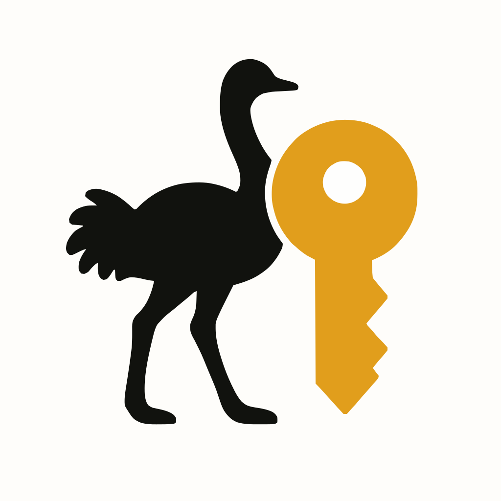

<div align="center">
  
  <h1>Nosskey SDK</h1>
  <p>SDK for Nostr keys wrapped with passkeys</p>
</div>

## Overview and Purpose of Nosskey

Nosskey (a portmanteau of "**Nos**tr" and "pass**key**") is a securely managing Nostr private keys and signing events using WebAuthn (passkey) technology. While secure management of private keys has been a challenge in the Nostr protocol, this SDK achieves both high security and excellent user experience by utilizing passkey technology.

This SDK inherits the concept from the previously developed [nosskey](https://github.com/ocknamo/nosskey), but represents a completely different approach thanks to a breakthrough made possible by utilizing the WebAuthn PRF extension.

## Benefits of Integrating Passkeys (WebAuthn) with Nostr

Traditional Nostr private key management methods, such as plaintext storage or password-protected format (NIP-49), have presented challenges in terms of security and convenience. Using WebAuthn offers the following benefits:

- **Phishing Resistance**: Domain validation prevents authentication on fraudulent sites
- **Passkey Synchronization**: Compatible providers can sync the credential. Wrapped keys additionally require a backup of their `NostrKeyInfo`, which holds the encrypted `wrapped.payload`; passkey sync alone does not back up that payload.
- **Cross-Device Support**: OS passkey synchronization features provide the same experience across multiple devices (wrapped keys also need their `NostrKeyInfo` on each device)

## Key Features

- 📲 **Biometric Authentication**: Integration with passkey authentication such as fingerprint and face recognition
- 🔐 **Phishing Resistance**: Domain validation prevents unauthorized use on phishing sites
- ⚡ **Fast Processing**: Efficient implementation utilizing WebAuthn PRF extension
- 🔄 **Cross-Device Support**: Available on multiple devices through OS passkey synchronization (wrapped keys also need their saved `NostrKeyInfo`)
- ✉️ **Encrypted Messaging**: Built-in NIP-44 (v2) and NIP-04 (legacy) encrypt/decrypt for direct messages

## Installation

```bash
npm install nosskey-sdk
```

## Basic Usage Examples

### Creating a Passkey and Generating a New Nostr Key

```javascript
import { NosskeyManager } from 'nosskey-sdk';

const keyMgr = new NosskeyManager();

// Create a passkey (displays browser's passkey UI)
const credentialId = await keyMgr.createPasskey();

// Use PRF value directly as a Nostr key
const keyInfo = await keyMgr.createNostrKey(credentialId);
keyMgr.setCurrentKeyInfo(keyInfo);

// Get the public key
const publicKey = await keyMgr.getPublicKey();
console.log(`Public key: ${publicKey}`);

// Sign an event
const event = {
  kind: 1,
  content: 'Hello Nosskey!',
  tags: [],
  created_at: Math.floor(Date.now() / 1000)
};
const signedEvent = await keyMgr.signEvent(event);
```

### Returning to an existing account

Use `loginWithPasskey()` for sign-in, not `createNostrKey()`. It does not set the current key, so pass the key info you pick to `setCurrentKeyInfo()`:

```javascript
import { hexToBytes, isNostrKeyInfo } from 'nosskey-sdk';

// chooseAccount, askForSavedKeyInfo and confirmDerive are your app's UI.
const result = await keyMgr.loginWithPasskey();
if (result.status === 'restored') {
  keyMgr.setCurrentKeyInfo(result.keyInfo);
} else if (result.status === 'ambiguous') {
  // Several accounts use this passkey: let the user pick one
  keyMgr.setCurrentKeyInfo(await chooseAccount(result.candidates));
} else {
  // 'unknown': no key info for this passkey on this device.
  // e.g. let the user pick an entry from a backup file (backupKeyInfo() / listKeyInfos() output)
  const saved = await askForSavedKeyInfo(result.credentialId);
  if (isNostrKeyInfo(saved) && saved.credentialId.toLowerCase() === result.credentialId) {
    keyMgr.setCurrentKeyInfo(saved);
  } else if (await confirmDerive()) {
    // Restores a direct-mode account; a passkey used only for a wrapped key gets a different identity
    const keyInfo = await keyMgr.createNostrKey(hexToBytes(result.credentialId));
    keyMgr.setCurrentKeyInfo(keyInfo);
  }
}
```

An `unknown` result is not evidence that the passkey was used in direct mode. Deriving with `createNostrKey()` restores a direct-mode account (for example, a synced passkey on a new device), but yields a different identity if the passkey was used only for a wrapped key, so ask the user before deriving. To restore saved key info instead, pass it to `setCurrentKeyInfo()`. `isNostrKeyInfo()` only checks its shape, so also check that its `credentialId` matches the passkey the user just chose.

For ordinary sign-out, use `clearCurrentKeyInfo()`, which keeps the account registry. `clearStoredKeyInfo()` also deletes the registry, including wrapped payloads, and so does `setStorageOptions({ enabled: false })`. With `registryEnabled: false` there is no registry, so `clearCurrentKeyInfo()` also discards the only stored copy of a wrapped payload (and setting another account overwrites it). Before deleting, save `listKeyInfos()` (all registry accounts; empty when the registry is disabled) or `backupKeyInfo()` (the current account), or keep another recovery route such as the original private key. A wrapped payload needs its original passkey to decrypt; keep backups private because they contain account and credential metadata.

### Encrypting and Decrypting Messages (NIP-44)

```javascript
// peerPubkey is the counterparty's public key (32-byte hex)
const ciphertext = await keyMgr.nip44Encrypt(peerPubkey, 'Hello, this is a secret');
const plaintext = await keyMgr.nip44Decrypt(peerPubkey, ciphertext);

// NIP-04 (legacy DM) is also available with the same signature
const legacyCiphertext = await keyMgr.nip04Encrypt(peerPubkey, 'Legacy DM');
const legacyPlaintext = await keyMgr.nip04Decrypt(peerPubkey, legacyCiphertext);
```

### Advanced Configuration Examples

```javascript
// Use nosskey-sdk.pages.dev for development environment
let rpId = location.host;
if (location.host.includes('nosskey-sdk.pages.dev')) {
  rpId = 'nosskey-sdk.pages.dev';
// Use 'nosskey.app' instead of subdomains (like 'www.nosskey.app')
} else if (location.host.includes('nosskey.app')) {
  rpId = 'nosskey.app';
}

// Initialize NosskeyManager with detailed configuration
const keyMgr = new NosskeyManager({
  // Cache options
  cacheOptions: {
    enabled: true,              // Enable caching
    timeoutMs: 60 * 1000,       // Cache timeout (60 seconds)
  },
  // Storage options
  storageOptions: {
    enabled: true,              // Enable automatic NostrKeyInfo storage
    storageKey: 'nosskey_pwk',  // Storage key name
  },
  // PRF options (can only be set during initialization)
  prfOptions: {
    rpId,                       // Relying Party ID (domain)
    userVerification: 'required', // Require user verification
  },
});
```

## API Reference

### NosskeyManager Methods

#### Constructor
- `constructor(options?)` - Initialize NosskeyManager with optional cache and storage options

#### Key Management
- `createPasskey(options?)` - Create a new passkey with PRF extension
- `createNostrKey(credentialId?, options?)` - Generate NostrKeyInfo using PRF value as the private key (direct mode)
- `importNostrKey(seckey, credentialId?, options?)` - Encrypt an existing 32-byte private key with the passkey and return NostrKeyInfo (wrap mode)
- `loginWithPasskey()` - Sign in with a passkey and look up the stored NostrKeyInfo linked to it (`restored` / `ambiguous` / `unknown`)
- `exportNostrKey(keyInfo, credentialId?)` - Export the private key in hexadecimal format

#### Key Information Management
- `setCurrentKeyInfo(keyInfo)` - Set the current NostrKeyInfo and save to storage if enabled (also added to the account registry when enabled)
- `getCurrentKeyInfo()` - Get the current NostrKeyInfo from memory or storage
- `reloadCurrentKeyInfo()` - Re-read the current NostrKeyInfo from storage
- `hasKeyInfo()` - Check if NostrKeyInfo exists in memory or storage
- `listKeyInfos()` - List every NostrKeyInfo in the account registry
- `findKeyInfosByCredentialId(credentialId)` - Find all stored NostrKeyInfo entries linked to a credential ID
- `backupKeyInfo(pubkey?, credentialId?)` - Return a copy of a NostrKeyInfo (including `wrapped.payload`) for backup
- `removeKeyInfo(pubkey, credentialId)` - Remove an account from the registry
- `clearCurrentKeyInfo()` - Sign out: clear the current key but keep the account registry
- `clearStoredKeyInfo()` - Delete all stored key info, including the account registry and wrapped payloads

#### NIP-07 Compatible Methods
- `getPublicKey()` - Get the public key from the current NostrKeyInfo
- `signEvent(event)` - Sign a Nostr event using the current NostrKeyInfo
- `signEventWithKeyInfo(event, keyInfo, options?)` - Sign a Nostr event with specified NostrKeyInfo

#### NIP-44 / NIP-04 Encryption Methods
- `nip44Encrypt(peerPubkey, plaintext)` - Encrypt a message for a peer using NIP-44 v2
- `nip44Decrypt(peerPubkey, ciphertext)` - Decrypt a NIP-44 v2 message from a peer
- `nip04Encrypt(peerPubkey, plaintext)` - Encrypt a message for a peer using NIP-04 (legacy, AES-256-CBC)
- `nip04Decrypt(peerPubkey, ciphertext)` - Decrypt a NIP-04 (legacy) message from a peer

#### Cache Management
- `setCacheOptions(options)` - Update cache configuration
- `getCacheOptions()` - Get current cache configuration
- `clearCachedKey(credentialId)` - Clear cache for a specific key
- `clearAllCachedKeys()` - Clear all cached keys

#### Storage Management
- `setStorageOptions(options)` - Update storage configuration for NostrKeyInfo (`enabled: false` deletes all stored key info, including the registry)
- `getStorageOptions()` - Get current storage configuration

#### Utility Methods
- `isPrfSupported()` - Check if the PRF extension is supported in the current environment

## iframe Mode (Cross-origin Signing)

Nosskey can be embedded as an iframe signing provider so that multiple Nostr
web apps share a single passkey bound to the Nosskey host origin. The
companion package [`nosskey-iframe`](packages/nosskey-iframe) ships both the
host-side bridge and a parent-page client. For standalone usage of the
package on its own, see [`packages/nosskey-iframe/README.md`](packages/nosskey-iframe/README.md).

### Browser Support

| Browser | PRF extension | iframe + WebAuthn | Status |
|---------|---------------|-------------------|--------|
| Chrome 118+ | ✅ | ✅ (with Permissions Policy) | Supported |
| Firefox (latest) | partial | spec-compliant | Limited |
| Safari / iOS | partial (Safari 18) | unstable in iframes | **Not supported** |

### Parent-side usage

```ts
import { NosskeyIframeClient } from 'nosskey-iframe';

const client = new NosskeyIframeClient({
  iframeUrl: 'https://nosskey.app/#/iframe',
});
await client.ready();

window.nostr = {
  getPublicKey: () => client.getPublicKey(),
  signEvent:    (event) => client.signEvent(event),
};
```

`NosskeyIframeClient` mounts the iframe with
`allow="publickey-credentials-get; publickey-credentials-create"`, which is
required for Chrome to execute WebAuthn inside the embedded frame. The host
server must also return
`Permissions-Policy: publickey-credentials-get=*, publickey-credentials-create=*`.

For a complete step-by-step guide to embedding the iframe into your own app, see [docs/en/iframe-integration.en.md](docs/en/iframe-integration.en.md).
If an AI coding agent will do the integration, give it [`llms.txt`](llms.txt) (also served at https://nosskey.app/llms.txt) or the self-contained [AI integration guide](docs/llms/nosskey-iframe-login.md).

See [`examples/svelte-app`](examples/svelte-app) (route `#/iframe`) for a reference host implementation. The host architecture is documented in detail at [docs/en/iframe-host.en.md](docs/en/iframe-host.en.md).

For a working parent-app sample, see [`examples/parent-sample`](examples/parent-sample). A live build is hosted at [https://ocknamo.github.io/nosskey-sdk/](https://ocknamo.github.io/nosskey-sdk/), where you can try the embedding flow in the browser.

#### Storage partitioning

Chrome 115+ and Firefox's Total Cookie Protection **partition third-party
iframe `localStorage` per top-level origin**. A passkey info record saved at
`nosskey.app` (first-party) is not visible to the iframe embedded in a
different parent origin, so the first call returns `NO_KEY`.

The reference host (`#/iframe`) recovers by calling
`document.requestStorageAccess({ all: true })` on a user gesture and
auto-toggles the iframe's visibility via a `nosskey:visibility` postMessage
(handled inside `NosskeyIframeClient`). See
[docs/en/iframe-host.en.md](docs/en/iframe-host.en.md#storage-partitioning--storage-access-api)
for details. If you build a custom host, implement the same flow.

## Supported Environments

Nosskey SDK works in browser environments that support WebAuthn and the PRF extension. Passkey generation and authentication also require authenticators from compatible OS/devices. The main compatibility status is as follows:

- **Chrome and Chromium-based browsers**: Supported in version 118 and later
- **Safari**: Supported in macOS 14.0 (Sonoma) and later, iOS 17 and later
- **Firefox**: Supports WebAuthn, but PRF extension support is limited

For detailed compatibility information, please refer to the [PRF Support Tables](docs/en/prf-support-tables.en.md).

## Sample Application

Details of the sample application can be found in [examples/svelte-app](examples/svelte-app/README.md). This application provides a demo combining Passkey and Nostr using the features of the Nosskey SDK.

To see it in action, visit the online demo: [https://nosskey.app](https://nosskey.app).

## License Information

This project is released under the MIT License. For details, please refer to the [LICENSE](LICENSE) file.

## Detailed Documentation

For more detailed implementation and specifications, please refer to the following documents:

- [Nosskey Specification](docs/en/nosskey-specification.en.md) - Basic concepts and implementation approaches
- [SDK Interface](docs/en/nosskey-sdk-interface.en.md) - API details and usage examples
