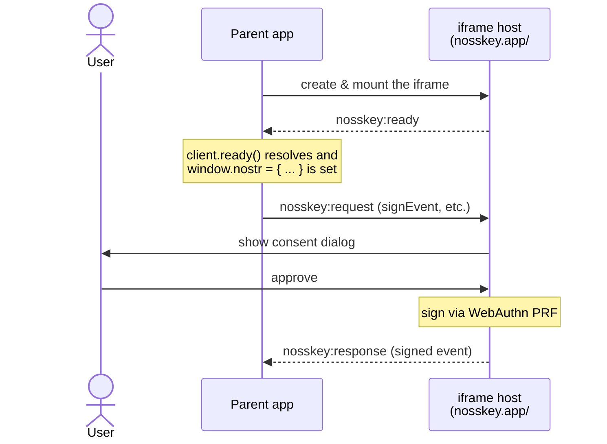

# Nosskey iframe Integration Guide (for parent apps)

> **Note:** This is a beta feature still under development and may not be fully tested.

> **Note:** The Japanese version ([`iframe-integration.ja.md`](../ja/iframe-integration.ja.md)) is the original document. This English version is a machine translation, so its accuracy cannot be guaranteed. If anything is unclear, please refer to the Japanese version.

This document is a step-by-step guide for **developers who want to embed the Nosskey signing iframe into their own Nostr web app**. Using the production host [`https://nosskey.app/#/iframe`](https://nosskey.app/#/iframe) as the example, it explains how to integrate via the `NosskeyIframeClient` from the [`nosskey-iframe`](../../packages/nosskey-iframe) package.

> For the internal architecture of the iframe host side (the `#/iframe` route of `examples/svelte-app`), see [`iframe-host.en.md`](./iframe-host.en.md).
>
> If an AI coding agent will do the integration, give it the [AI integration guide](../llms/nosskey-iframe-login.md), a single file with the rules and copy-paste code.

## Overview

Embedding `nosskey.app/#/iframe` as an iframe lets your parent app use Nostr signing and encryption.

- The parent app obtains a [NIP-07](https://github.com/nostr-protocol/nips/blob/master/07.md) compatible `window.nostr` API. It can be dropped into existing Nostr clients.
- Every app that embeds it shares the same passkey, so users can reuse a single "Nosskey identity" across multiple Nostr apps.

Intended audience: developers of cross-origin Nostr web apps.

## How it works

The parent page and the iframe exchange JSON-RPC-style messages over `window.postMessage`. `NosskeyIframeClient` hides this communication, so you do not need to write `postMessage` yourself.



Key points:

- **`nosskey:ready` handshake**: wait for the iframe to finish initializing with `client.ready()` before use.
- **Consent dialogs render inside the iframe**: signing and encryption, as well as `getPublicKey()` / `getRelays()`, go through user consent (a per-origin connection approval for the latter two). The dialog is rendered within the iframe.
- **Automatic visibility toggling**: when a dialog or storage permission is needed, the iframe sends a `nosskey:visibility` message to the parent, and `NosskeyIframeClient` automatically shows/hides the iframe element.

## Prerequisites

- **Browser**: works on Chrome 118+ and Safari / iOS (Safari 18+, macOS 15 / iOS 18+). Safari behaves differently from Chrome in parts (for example, granting storage access needs a user tap). Firefox has limited PRF support.
- **HTTPS**: the parent page must be served over HTTPS (or `localhost`). This is a WebAuthn requirement.
- **Passkey created in advance**: the user must first open `https://nosskey.app` directly and create a passkey (Nosskey identity). If none exists, signing-related methods return a `NO_KEY` error.

## Installation

```sh
npm install nosskey-iframe
```

The client side has no runtime dependency on `nosskey-sdk`. `nosskey-sdk` is an optional peer dependency, needed only when you host the signing iframe yourself. Types such as `NostrEvent` can be imported from `nosskey-iframe`.

## Quick start

```ts
import { NosskeyIframeClient } from 'nosskey-iframe';

const client = new NosskeyIframeClient({
  iframeUrl: 'https://nosskey.app/#/iframe',
});

// Wait for the iframe to become ready (nosskey:ready)
await client.ready();

// Expose a NIP-07 compatible window.nostr
window.nostr = {
  getPublicKey: () => client.getPublicKey(),
  signEvent: (event) => client.signEvent(event),
  getRelays: () => client.getRelays(),
  nip44: {
    encrypt: (peer, plaintext) => client.nip44.encrypt(peer, plaintext),
    decrypt: (peer, ciphertext) => client.nip44.decrypt(peer, ciphertext),
  },
  nip04: {
    encrypt: (peer, plaintext) => client.nip04.encrypt(peer, plaintext),
    decrypt: (peer, ciphertext) => client.nip04.decrypt(peer, ciphertext),
  },
};
```

The `NosskeyIframeClient` constructor creates the iframe element and appends it to `document.body` (or to the `container` described below). The iframe is automatically given the `allow="publickey-credentials-get; publickey-credentials-create"` attribute required for WebAuthn.

This is a minimal example to show how the client works: it creates the client on page load and overwrites `window.nostr`. In a real app, follow these two rules.

- Create the client only when it is first needed, for example when the user clicks "Log in with Nosskey". In a browser where no key can be found, the iframe may open by itself right after it is mounted (see [Handling storage partitioning](#handling-storage-partitioning)).
- If you also offer login through a NIP-07 browser extension, do not overwrite `window.nostr`. Switch the signer according to the login method instead.

## Supported methods

`NosskeyIframeClient` provides all 7 NIP-07 methods, and all 7 go through user consent.

| Client API | Return type | Consent | Purpose |
|------------|-------------|---------|---------|
| `getPublicKey()` | `Promise<string>` | required (connection approval) | Returns the public key (hex) |
| `getRelays()` | `Promise<RelayMap>` | required (connection approval) | Returns the relay configuration |
| `signEvent(event)` | `Promise<NostrEvent>` | required | Signs a Nostr event |
| `nip44.encrypt(peer, plaintext)` | `Promise<string>` | required | NIP-44 v2 encryption |
| `nip44.decrypt(peer, ciphertext)` | `Promise<string>` | required | NIP-44 v2 decryption |
| `nip04.encrypt(peer, plaintext)` | `Promise<string>` | required | NIP-04 (legacy) encryption |
| `nip04.decrypt(peer, ciphertext)` | `Promise<string>` | required | NIP-04 (legacy) decryption |

- Consent for `getPublicKey()` / `getRelays()` is a **per-origin connection approval (pairing)**, like the first connect in a NIP-07 browser extension. The npub and relay set identify the user, so this stops embedding sites from reading them silently.
- Pressing "Always allow" in the dialog is remembered per origin and per category (connect / sign / NIP-44 / NIP-04), and from then on the iframe answers requests of that category without a dialog. Always allowing connect does not allow signing. **The decryption dialog has no "Always allow" button**, so decryption is confirmed every time (unless the global setting below is "always deny", in which case it is rejected without a dialog).
- In nosskey.app's settings, the user can also choose a default for all sites per category (ask every time, always allow, always deny). The default is to ask every time.
- Exception: when the iframe cannot read a key (including when storage access has not been granted), `getRelays()` returns `{}` without consent. Do not read `{}` as "the user has no relays".

`peer` is the counterparty public key (32-byte hex). `RelayMap` is of type `Record<string, { read: boolean; write: boolean }>`.

> NIP-04 is a legacy, unauthenticated scheme (AES-CBC). Use NIP-44 v2 for new implementations. NIP-04 is kept only for interoperability with older clients.

## Client options

The `NosskeyIframeClient` constructor takes `NosskeyIframeClientOptions`.

| Option | Type | Default | Description |
|--------|------|---------|-------------|
| `iframeUrl` | `string` | (required) | Absolute URL of the Nosskey iframe. e.g. `https://nosskey.app/#/iframe` |
| `container` | `HTMLElement` | `document.body` | Parent element the iframe is appended to |
| `timeout` | `number` | `60000` | Request timeout in milliseconds |
| `theme` | `'purple-dark' \| 'purple-light' \| 'neutral-dark' \| 'neutral-light' \| 'auto'` | (unset) | Theme passed to the iframe. `auto` is resolved inside the iframe via `prefers-color-scheme`. Legacy `'light'` / `'dark'` are still accepted and resolve to the purple variants |
| `lang` | `'ja' \| 'en' \| 'auto'` | (unset) | Language passed to the iframe. `auto` is resolved inside the iframe via `navigator.language` |

- When `theme` / `lang` is set, `?embedded=1&theme=...&lang=...` is automatically appended to the iframe URL.
- `theme` / `lang` are **applied only when the iframe loads**. To switch them at runtime, call `destroy()` and re-create the client with the new values.

## Placing the iframe and visibility control

The iframe created by `NosskeyIframeClient` is initially hidden with `display: none`. While a request is being handled (a consent dialog for connection approval, signing, encryption, etc.) or when a storage access permission is needed, the iframe sends a `nosskey:visibility` message (`{ type: 'nosskey:visibility', visible: boolean }`), and `NosskeyIframeClient` automatically toggles the iframe element's `display`.

Even a request auto-approved through "always allow" shows the iframe briefly while it is handled. Matching the iframe background to `theme` keeps this unobtrusive.

However, **where and at what size the iframe is placed is the parent app's responsibility**. Place the iframe somewhere visible on screen so the user can interact with the consent dialog. The recommended pattern is a modal / overlay.

```ts
const client = new NosskeyIframeClient({
  iframeUrl: 'https://nosskey.app/#/iframe',
  theme: 'neutral-light', // match the modal card's background (#fff)
  lang: 'auto',
});

// Get the created iframe element and move it into a modal card
const modalCard = document.querySelector('#nosskey-modal .card');
modalCard.appendChild(client.iframe);

await client.ready();
```

- `client.iframe` gives you the iframe element (`HTMLIFrameElement`). Use CSS to set its size, position, and `z-index`.
- If the parent app also wants to show a backdrop, watch the `style` attribute of `client.iframe` with a `MutationObserver` and show or hide the modal frame to match its `display`. Subscribing to `message` events on `window` directly means writing your own sender checks. `NosskeyIframeClient` checks the sender before it switches `display`, so use this approach.

```ts
const observer = new MutationObserver(() => {
  modal.classList.toggle('visible', client.iframe.style.display !== 'none');
});
observer.observe(client.iframe, { attributes: true, attributeFilter: ['style'] });
```

- Be careful if the login modal uses the native `<dialog>` element's `showModal()`. A modal `<dialog>` is placed in the browser's top layer, so no `z-index` can put the iframe above it. Everything outside the `<dialog>` also becomes inert, the iframe included. Build the modal from ordinary elements, or close the `<dialog>` before starting the Nosskey login.
- When started in embedded mode (`embedded=1`, by specifying `theme` / `lang`), the iframe makes its body transparent so the consent modal blends into the card frame the parent provides. The card frame's background shows through the transparent parts, so fix `theme` to match it (`#fff` for `neutral-light` / `purple-light`, `#141414` for `neutral-dark`, `#131318` for `purple-dark`). `'auto'` is resolved inside the iframe and can disagree with the parent's background.

## Handling storage partitioning

With Chrome 115+ and Firefox's Total Cookie Protection, **a cross-origin iframe's `localStorage` is partitioned per top-level origin**. Passkey info saved while `nosskey.app` was the top-level page is not visible, at first, to the iframe embedded in a different parent origin.

The iframe host automatically recovers from this via the Storage Access API:

1. When a request such as `getPublicKey()` / `signEvent()` arrives while the key cannot be read, the iframe sends `nosskey:visibility { visible: true }` to show itself. When granting storage access could make the key readable, it does not answer `NO_KEY` right away, but holds the request. When there is no such prospect (see below), it answers `NO_KEY` at once.
2. The user clicks the "Grant storage access" button inside the iframe.
3. The browser shows a permission dialog. On approval, the iframe re-reads the key from first-party storage and continues with the held request (the consent dialog, for example). The parent app does not need to retry.
4. If the user closes the card, or the key is still missing after access is granted, `NO_KEY` is returned. The request is held for at most 60 seconds. If the client's timeout (60 seconds by default) expires first, the call fails with a timeout error.

When no key can be found and waiting will not help (storage access is granted but there is no key, or the browser has no Storage Access API and cannot see a key), the iframe shows itself without waiting for a request, and offers to open `nosskey.app`. This check runs when the iframe is mounted and every time the tab becomes visible again. The user can close the card.

This flow is handled automatically by the host and `NosskeyIframeClient`, but **you must place the iframe somewhere visible so the user can click the "Grant storage access" button** (see the previous section). The iframe host's status card also includes a link to open `nosskey.app` in a separate tab. This is a path for the user to create a passkey (Nosskey identity) or sign in at first-party scope, primarily for the case where no key exists yet. Note that if the browser partitions storage and the Storage Access API permission cannot be obtained, the user needs to grant the permission again.

### Never remount the iframe

Mount the iframe once and leave it mounted for the life of the page. **Do not `destroy()` and remount it on `visibilitychange`, focus, or route changes.**

Browsers scope a Storage Access grant to the **document**. A live iframe keeps its grant across tab switches; a remounted one starts over, so the user is asked to grant storage access every single time they come back to your tab. On iOS Safari this is the difference between one prompt and a prompt on every tab switch.

Remounting used to be the only way to notice that the user had switched accounts in the signing app, because the iframe read the account once at mount. It is no longer needed: the host re-reads the stored account before serving each request, so **a long-lived iframe picks up both account switches and sign-outs on the next call**. You do **not** need to call anything to check for a change — the next call you actually need answers for whatever account is current then.

> Avoid polling `getPublicKey()` on every `visibilitychange`. `getPublicKey()` is subject to connection approval, so unless the user chose "always allow", **a consent dialog appears every time they return to the tab**. And while storage access has not been granted, a host with `onKeyUnavailable` (the reference implementation has it) does **not** answer `NO_KEY` right away: it reveals the iframe and waits up to 60 seconds for the user. Calls that end without recovery also count toward the per-origin rate limiter, which blocks with `RATE_LIMITED` after five consecutive ones by default. Restore the session from a pubkey the parent app saved itself, and query the iframe only in response to a user action.

See [`iframe-host.en.md`](./iframe-host.en.md#storage-partitioning--storage-access-api) for details.

## Error handling

When the iframe returns an error response, the corresponding method's Promise rejects with a `NosskeyIframeError`. Use `error.code` to distinguish error types.

```ts
import { NosskeyIframeError } from 'nosskey-iframe';

try {
  const pubkey = await client.getPublicKey();
} catch (err) {
  if (err instanceof NosskeyIframeError) {
    if (err.code === 'NO_KEY') {
      // No passkey is configured in the iframe, or the key is hidden by storage partitioning
    } else if (err.code === 'USER_REJECTED') {
      // The user denied the request in the consent dialog
    }
  }
}
```

| Error code | Meaning |
|------------|---------|
| `NO_KEY` | No passkey is configured in the iframe, or the key is hidden by storage partitioning |
| `USER_REJECTED` | The user denied the request in the consent dialog |
| `RATE_LIMITED` | Five rejections, or requests whose key could not be recovered, in a row from this origin; the host is temporarily refusing requests. Back off and retry later |
| `NOT_AUTHORIZED` | The requesting origin is not allowed |
| `UNKNOWN_METHOD` | An unsupported method was called |
| `INVALID_REQUEST` | The parameters are invalid |
| `INTERNAL` | An internal error inside the iframe |

In addition, a request that exceeds `timeout` (default 60 seconds) rejects with a plain `Error`.

An `INTERNAL` whose message reads `The document is not focused.` is WebKit refusing `navigator.credentials.get()` for one reason only: the calling document is not the focused one. Hosts built on `NosskeyIframeHost` pull focus into their own document right before signing, so you should not normally see it. If you are talking to a hand-rolled host, pass the constraint along ([`iframe-host.en.md`](./iframe-host.en.md#webauthn-and-document-focus-webkit)).

## Cleanup

Call `destroy()` when the client is no longer needed. It removes the iframe element, detaches the `message` listener, and rejects any pending requests.

```ts
client.destroy();
window.nostr = undefined;
```

Use `destroy()` only when you are **actually done** (leaving the page, tearing the app down). Calling it to refresh the account state costs you the Storage Access grant and makes the user grant it again — see "Never remount the iframe" above.

## Full example

For a working parent-app implementation, see [`examples/parent-sample`](../../examples/parent-sample) in the repository. It is a Vanilla TypeScript + Vite app that demonstrates modal placement, `window.nostr` setup, calls to each NIP method, and `NO_KEY` handling.

A live build of this sample is hosted at [https://ocknamo.github.io/nosskey-sdk/](https://ocknamo.github.io/nosskey-sdk/), where you can try the embedding flow in the browser.

A snippet of the key modal placement:

```ts
const client = new NosskeyIframeClient({ iframeUrl, theme, lang });
// Move the created iframe into the modal card
modalCard.appendChild(client.iframe);
await client.ready();
window.nostr = {
  /* ... see "Quick start" above ... */
};
```

## Production notes

- **`allow` attribute**: the `allow="publickey-credentials-get; publickey-credentials-create"` attribute required to run WebAuthn inside the iframe is added automatically by `NosskeyIframeClient`. Nothing to wire up on the parent side.
- **Permissions-Policy header**: the iframe host must return a `Permissions-Policy: publickey-credentials-get=*, publickey-credentials-create=*` header. `nosskey.app` already does this.
- **Browser support**: see the table below.

| Browser | PRF extension | iframe + WebAuthn | Status |
|---------|---------------|-------------------|--------|
| Chrome 118+ | ✅ | ✅ (with Permissions-Policy) | Supported |
| Firefox (latest) | limited | spec-compliant | Limited |
| Safari / iOS | ✅ (Safari 18+, macOS 15 / iOS 18+) | ✅ (some behaviour differs from Chrome) | Supported |

If you want to host the iframe host yourself, [`iframe-host.en.md`](./iframe-host.en.md) explains the host-side architecture (`NosskeyIframeHost`, the consent flow, Permissions-Policy).

## Related documentation

- [iframe host explanation](./iframe-host.en.md) — how the iframe host that runs on the `#/iframe` route works
- [`nosskey-iframe` package](../../packages/nosskey-iframe) — source code
- [`examples/parent-sample`](../../examples/parent-sample) — parent-app implementation example
- [Live parent-app demo](https://ocknamo.github.io/nosskey-sdk/) — hosted build of `examples/parent-sample`
- [Root README](../../README.md) — overview of the Nosskey SDK as a whole
- [Nosskey Specification](./nosskey-specification.en.md)
